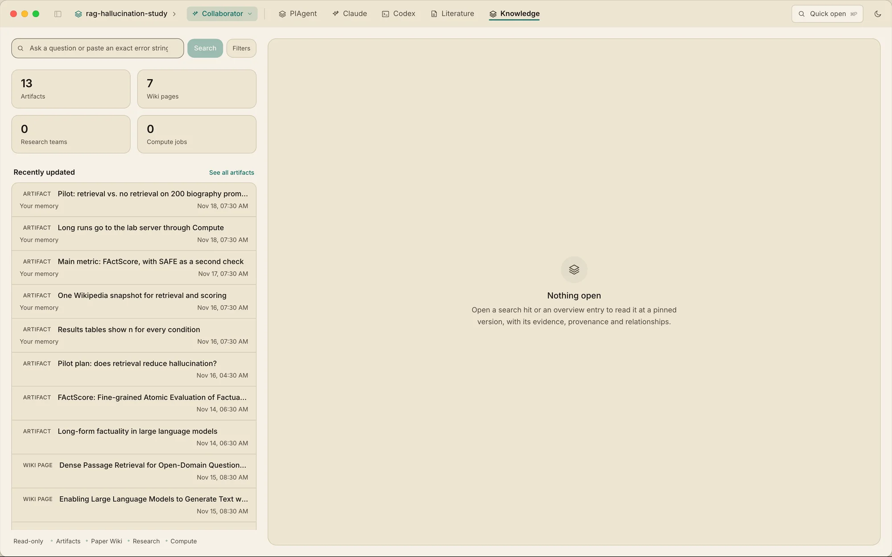
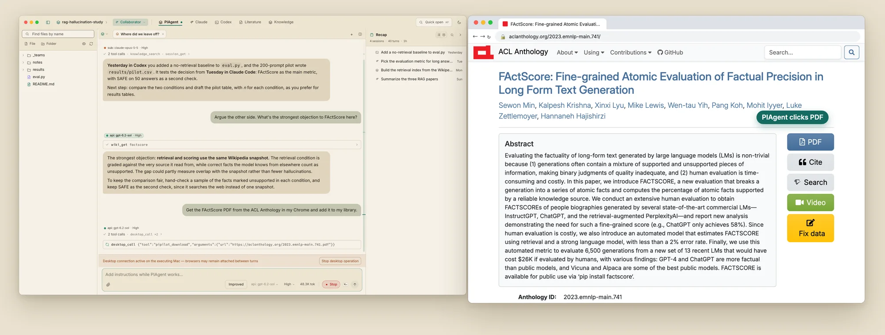
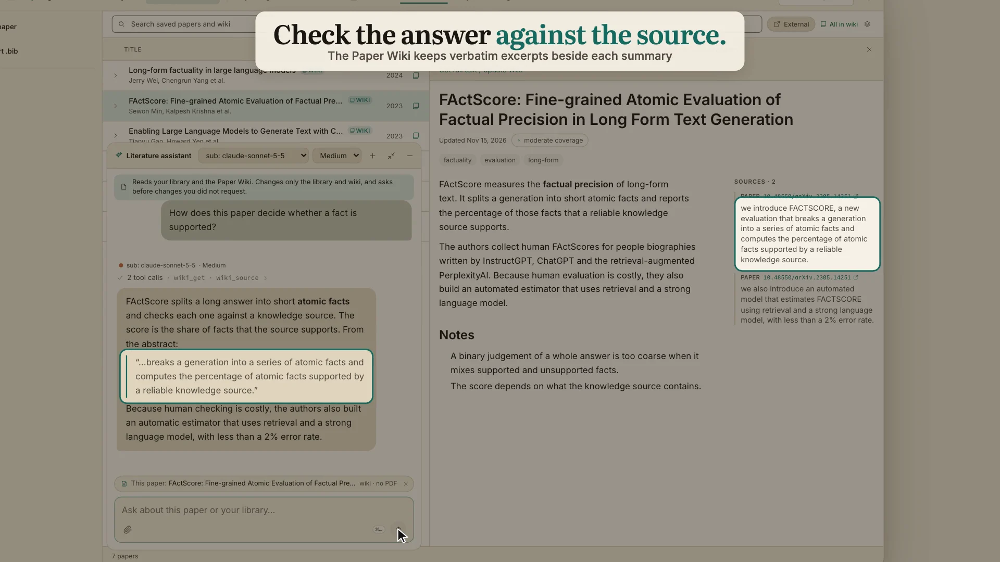

<h1 align="center">Research Pilot</h1>

<strong>A research workspace that remembers.</strong> 
Claude Code, Codex and the built-in PIAgent in one desktop app — with your papers, decisions and evidence kept after the conversation ends.

<a href="https://github.com/daidong/DIR-Agent/releases/tag/v0.8.12"><strong>Download 0.8.12</strong></a> ·
<a href="https://daidong.github.io/DIR-Agent/">Website</a> ·
<a href="https://youtu.be/RheGeG1U5no">Watch the film</a> ·
<a href="https://github.com/daidong/DIR-Agent/releases/tag/v0.8.12">Release notes</a> ·
<a href="https://github.com/daidong/DIR-Agent/issues">Report a problem</a>

macOS (Apple Silicon) · Ubuntu / Debian (x86-64 and ARM64) 
Works with Claude and ChatGPT subscriptions, GitHub Copilot, Anthropic and OpenAI API keys, Google Cloud Vertex AI, or your own model server.

## Why

**Monday, you explain your project. Tuesday, you explain it again.** AI agents are good at research work, but each chat starts from nothing. Research Pilot gives every agent in a project the same papers, the same Paper Wiki and the same memory of what you decided — with dates and sources you can check.

## New in 0.8.12

- **Long agent turns take less room.** The thinking and tool calls between two pieces of visible text fold into one line. Open it to inspect every step, error, edited file and thought. Failed steps stay visible, and a short recap lists what happened while you were away. The phone folds the same way.
- **Gemini through Google Cloud Vertex AI.** **Settings → Google Cloud** connects your own Vertex AI project with Application Default Credentials and adds its Gemini chat models to PIAgent.
- **Settings and model picker.** PIAgent settings are split into focused pages (Models, API keys & local, Google Cloud, Web search, Desktop control). The model picker is searchable and groups models by subscription, API & cloud, and self-hosted.
- **Linux users of 0.8.8–0.8.11:** those Linux packages were withdrawn because they were packaged incorrectly. Install 0.8.12.

[Full release notes](https://github.com/daidong/DIR-Agent/releases/tag/v0.8.12)

## What it does

### Ask your papers. Check the answer against the source.

Open a paper in the **Literature** tab and ask the assistant about it, or about your whole library. Answers quote the paper, and the Paper Wiki keeps verbatim excerpts beside every summary, so you can check a claim at a glance.

- Search academic indexes and import papers into your library
- A Paper Wiki shared across your projects, with source excerpts
- Add a PDF as a paper's full text

### It remembers what you decided.

Agents save the decisions, preferences and lessons worth keeping — each with its date, the conversation it came from and the context it applies to. Next week, a new conversation starts from them instead of from zero.

- Browse, correct or forget any memory in the **Knowledge** tab
- Tell an agent not to remember something, and it won't
- Memories point back to their sources; they are not taken as fact

### One memory for PIAgent, Claude Code and Codex.

Run Claude Code and Codex in their own tabs, or work with the built-in PIAgent. They share the project's papers, Wiki and memory, and **Recap** lists every session in the project, whichever agent ran it.

- Claude Code and Codex run as their real CLIs, with your login
- PIAgent can read earlier Claude Code and Codex sessions
- Split panes keep a conversation beside your files

### Switch models mid-conversation.

Pick any model PIAgent can reach — a Claude, ChatGPT or GitHub Copilot subscription you already pay for, an Anthropic or OpenAI API key, Gemini on your Google Cloud project, or a model on your own server — and keep the same conversation going. Every reply is labelled with the model that wrote it.

- Subscription logins are shared with the Claude Code and Codex CLIs
- Set the reasoning effort per conversation
- Usage rings show how much of your plan is left

### Hand bigger questions to a team.

Ask PIAgent for a team and it drafts a brief: the goal, the scope, the model, the permissions, and when the team must ask you. Nothing runs until you click **Start team**. Then members, messages and results stay with the conversation.

- Research teams investigate; manuscript teams help you revise your draft
- Answer a team's questions from the card — or from your phone
- Every step and result is recorded

### It can use your browser, too (macOS).

With your approval, PIAgent can work in apps on your Mac — for example, fetch a PDF from a publisher page in your own signed-in Chrome, in the background. The conversation shows whenever a desktop connection is active, with a button to stop it.

- Approve per turn or per conversation
- Downloaded PDFs can go straight into your library
- macOS only for now

### Pick it up on your phone.

Pair your phone once and follow or drive the same sessions away from your desk: read replies, send the next message, change the model, follow a team and answer its questions. Your computer does the work; the phone is a window into it.

- PIAgent, Claude Code and Codex sessions
- Notifications when a team needs you
- Connects over Tailscale; your computer must stay on

### See it in action

A researcher's week, filmed in the real app.

## Download and start

| Computer | Recommended package | Alternative |
| --- | --- | --- |
| macOS · Apple Silicon (M1 or later) | [DMG](https://github.com/daidong/DIR-Agent/releases/download/v0.8.12/Research-Pilot-0.8.12-mac-arm64.dmg) | [ZIP](https://github.com/daidong/DIR-Agent/releases/download/v0.8.12/Research-Pilot-0.8.12-mac-arm64.zip) |
| Ubuntu/Debian · Intel / AMD 64-bit | [deb](https://github.com/daidong/DIR-Agent/releases/download/v0.8.12/Research-Pilot-0.8.12-linux-amd64.deb) | [AppImage](https://github.com/daidong/DIR-Agent/releases/download/v0.8.12/Research-Pilot-0.8.12-linux-x86_64.AppImage) |
| Ubuntu/Debian · ARM 64-bit | [deb](https://github.com/daidong/DIR-Agent/releases/download/v0.8.12/Research-Pilot-0.8.12-linux-arm64.deb) | [AppImage](https://github.com/daidong/DIR-Agent/releases/download/v0.8.12/Research-Pilot-0.8.12-linux-arm64.AppImage) |

On macOS, open the DMG and drag Research Pilot into Applications; the app is signed and notarized by Apple. On Ubuntu/Debian, install the downloaded deb with `sudo apt install ./Research-Pilot-0.8.12-linux-amd64.deb` (use the arm64 filename on ARM). AppImages on Ubuntu 24.04 may need `libfuse2t64`; the arm64 AppImage also needs `zlib1g-dev`.

1. **Install** the package for your computer. The app brings its own runtime — no Node.js, Docker or server to set up.
2. **Connect a model.** Sign in once with the Claude Code or Codex CLI from a terminal (PIAgent shares that login), sign in to GitHub Copilot under **Settings → Subscriptions**, add an Anthropic or OpenAI API key or your own model server under **Settings → API keys & local**, or connect Vertex AI under **Settings → Google Cloud**. On first launch the setup checklist says what is missing; **Settings → Setup** shows it any time.
3. **Open a project folder.** An existing repository or an empty folder both work. Your files stay where they are; research records live in `~/.pipilot`.
4. **Ask.** Try: “Explain this project and the research material already saved for it. Suggest one useful next step.”

Windows and Intel Macs are not supported yet. Choose a named application package; GitHub's automatic “Source code” archives are a snapshot of this documentation repository, not the application.

[Detailed installation and setup](docs/installation.md) covers CLI login, AppImage dependencies, optional tools, API keys, upgrades and troubleshooting.

## Good to know

### Work across computers

Connect another computer through **Settings → Servers** to open its projects from the desktop. Workspaces are grouped by computer, and the interface identifies the machine that owns the active project. Remote sessions, file previews and supported transfers use the connected instance.

### Choose how to work

**The agent is the execution engine.** Claude and Codex run their installed CLIs inside the app. PIAgent runs in a separate bundled process and supports configured model providers and compatible local endpoints. Their available tools and authentication differ; the app does not make them interchangeable.

**The work mode sets the session's defaults.** Use the workspace mode picker for Collaborator and enable the experimental choices to explore Ideator, Builder, Teacher, or Policy & Records. These emphasize general collaboration, exploring ideas, engineering, teaching, or source-based policy and record work. Modes are built in and cannot be edited; each new session uses the mode's current version. A mode is a starting style, not proof of better answers or a security sandbox.

Changing modes can end the workspace's ordinary foreground sessions. The app shows the affected sessions before you confirm and starts fresh sessions with the new mode. Changing PIAgent's model or reasoning effort is a separate choice; its workspace selection is restored after an app restart.

### Papers, knowledge, and memory

| Information | What it is for | Scope |
| --- | --- | --- |
| **Paper Wiki** | Source-backed summaries and connections you can revisit | Shared across projects |
| **Saved papers and notes** | The material a particular project relies on | Associated with the workspace |
| **Project memory** | Reusable preferences, configuration references and observed experience with sources and context | Ordinary sessions pre-load compact summaries; full records are read when needed |
| **Conversation history** | What happened in a session | Available for review and continuation |

The research workflow starts with existing knowledge, searches for gaps, reads original sources for exact claims, and saves useful material. Literature search supports academic indexes; general web search in PIAgent uses a Brave Search key configured under **Settings → Web search**. Full-text access depends on the paper and configured sources.

The **Domain knowledge** panel separately manages reusable rules. Turning a rule's **Use** switch on approves its current content for use. The workspace's **Load rules in conversations** switch controls loading. Opening the panel only marks rules as seen; it does not turn them on.

You can ask an agent not to remember particular information, correct a record, or forget it. Saved summaries still need checking against original evidence when accuracy matters.

### Teams

Use ordinary chat for quick work. For a larger research or writing task, ask PIAgent to prepare a team brief, review it, and click **Start team** yourself to authorize execution. Drafting a brief does not start work. You talk to a team in the PIAgent conversation that owns it, on desktop or phone.

Research and manuscript teams are separate launches: turning a research result into a manuscript requires a new writing brief and another **Start team** confirmation. Permissions and delivery checks apply; a completed task does not establish that a scientific conclusion is correct. Provider quotas and external service charges still apply. On Linux, team shell execution requires working `bubblewrap` isolation; it is refused when isolation is unavailable.

### Longer PIAgent sessions

PIAgent keeps large tool results in local storage and retrieves their original text when needed. Older conversation can be compressed while the complete session history remains available; the interface shows when this is happening. If a provider rejects an oversized request, PIAgent compacts and retries once. Provider limits still apply, and changing providers can require rebuilding the model's working context.

### Phone companion

Install and connect Tailscale on both devices, turn on **Settings → Phone** on the desktop and click **Show pairing code**. Scan the QR code with the phone's camera or type the six-digit code. A code pairs one phone, once, within ten minutes; each paired phone gets its own key and can be removed in Settings without affecting the others. For notifications on iOS, add the page to the Home Screen. HTTPS (Tailscale certificates) is needed for Home Screen install and notifications. [Phone setup and access controls](docs/installation.md#7-optional-follow-and-drive-sessions-from-your-phone).

### Permissions and your data

Desktop and phone sessions launch Claude Code with `--dangerously-skip-permissions` and Codex with `--dangerously-bypass-approvals-and-sandbox`. These agents can run commands, edit or delete files, and use the network with your OS account's permissions without per-action approval. Codex's own sandbox is disabled. This fixed launch behavior does not grant administrator privileges. Use trusted tasks and keep backups. PIAgent asks before risky commands, and desktop control needs your approval.

Research data lives under `~/.pipilot` by default. Your documents and code stay in the project folders you choose. Opening a workspace can synchronize integration files under `.agents`, `.claude` and `.pipilot`; your own `AGENTS.md` and `CLAUDE.md` content is preserved.

Local storage does not mean offline processing: model providers, search services and other configured tools receive the requests needed for their work. Credentials, account access and provider charges are configured separately.

Before upgrading, finish active work and quit the app. Replace the application, then reopen it so both the app and bundled services use the new version. Keep a backup of `~/.pipilot` and your project folders; do not delete research data as an upgrade step.

## Help

- [Installation, configuration and troubleshooting](docs/installation.md)
- [What changed in 0.8.12](https://github.com/daidong/DIR-Agent/releases/tag/v0.8.12) · [All releases](https://github.com/daidong/DIR-Agent/releases)
- [Issues](https://github.com/daidong/DIR-Agent/issues) — include app version, OS, CPU, package type and reproduction steps. Remove credentials and private research from diagnostics before sharing.

This public repository hosts application packages, documentation and community issues. The application source is maintained separately. Claude Code, Codex, ChatGPT, GitHub Copilot and other names belong to their owners; Research Pilot is not affiliated with Anthropic, OpenAI, Google or GitHub.
