# Research Pilot

**A desktop workspace for doing research with Claude Code, Codex, or the built-in PI Agent.**

Work on papers, code, experiments, and presentations in one project folder. Keep the papers you found, the decisions you made, and the evidence behind your results available when the conversation ends.

[Download 0.8.4](https://github.com/daidong/DIR-Agent/releases/tag/v0.8.4) · [Release notes](https://github.com/daidong/DIR-Agent/releases/tag/v0.8.4) · [Report a problem](https://github.com/daidong/DIR-Agent/issues)

## New in 0.8.4

- **Preserve usable PI context.** An unsuccessful early compaction no longer stops a session when its existing context still fits. Saved conversation images live outside the history JSON and are restored when needed.
- **Respect subscription model differences.** PI uses model-specific Codex context windows and preserves the Anthropic model identity needed to restore signed thinking history.
- **Keep PiPilot instructions in PiPilot sessions.** Claude and Codex receive PiPilot identity and rules at launch, rather than through edits to your project's `AGENTS.md` or `CLAUDE.md`. Existing PiPilot-managed blocks are retired; shared skills and delegate definitions remain available.
- **Ask Builder for evidence, not just assurances.** Updated Builder instructions ask agents to check completion claims against evidence from the current session. This is guidance to the model, not a guarantee that every claim is correct.

## What you can do

| You want to… | Start here | What stays available |
| --- | --- | --- |
| Read papers and compare evidence | Ask an agent; browse **Literature** and **Knowledge** | Saved papers, source links, Wiki pages and notes |
| Write, code, or prepare slides | Open a project and use **Claude**, **Codex**, or **PIAgent** | Project files and session history |
| Explore a research question over several steps | Create a plan in **Research**, revise it, then approve it | Plan versions, attempts, evidence, decisions and reports |
| Continue a project next week | Reopen its workspace | Project memory and prior work |
| Follow work away from your desk | Pair the optional phone companion | The same computer-hosted sessions and research views |

For example, ask: “Compare the methods in these three papers, find the strongest objection to my proposed experiment, and save a short plan with sources.” You can inspect the papers in Literature, revise the plan with the agent, and keep the resulting document in your project.

## Start in a few minutes

1. **Install Research Pilot** using the package for your computer below.
2. **Choose an agent.** For Claude or Codex, install that CLI and sign in from a terminal. For PI Agent, configure a model and authentication in **Settings → PI Agent**; its runtime is bundled.
3. **Open a project folder.** It can be an existing repository or an empty research folder.
4. **Run Settings → Environment check**, then open the agent tab and send a small request.

Try: “Explain this project and the research material already saved for it. Suggest one useful next step.”

| Computer | Recommended package | Alternative |
| --- | --- | --- |
| macOS · Apple Silicon | [DMG](https://github.com/daidong/DIR-Agent/releases/download/v0.8.4/Research-Pilot-0.8.4-mac-arm64.dmg) | [ZIP](https://github.com/daidong/DIR-Agent/releases/download/v0.8.4/Research-Pilot-0.8.4-mac-arm64.zip) |
| Ubuntu/Debian · Intel / AMD 64-bit | [deb](https://github.com/daidong/DIR-Agent/releases/download/v0.8.4/Research-Pilot-0.8.4-linux-amd64.deb) | [AppImage](https://github.com/daidong/DIR-Agent/releases/download/v0.8.4/Research-Pilot-0.8.4-linux-x86_64.AppImage) |
| Ubuntu/Debian · ARM 64-bit | [deb](https://github.com/daidong/DIR-Agent/releases/download/v0.8.4/Research-Pilot-0.8.4-linux-arm64.deb) | [AppImage](https://github.com/daidong/DIR-Agent/releases/download/v0.8.4/Research-Pilot-0.8.4-linux-arm64.AppImage) |

On macOS, open the DMG and drag Research Pilot into Applications. On Ubuntu/Debian, install the downloaded deb with `sudo apt install ./Research-Pilot-0.8.4-linux-amd64.deb` (use the arm64 filename on ARM).

The app includes its runtime and data service. Packaged use does not need Node.js, Docker, a source checkout, or a manually started server. Windows and Intel Mac installers are not included. Choose a named application package; GitHub's automatic “Source code” archives are the public repository snapshot, not the application.

[Detailed installation and setup](docs/installation.md) covers CLI login, AppImage dependencies, optional tools, API keys, upgrades and troubleshooting.

## Work across computers

Connect another computer through **Settings → Servers** to open its projects from the desktop. Workspaces are grouped by computer, and the interface identifies the machine that owns the active project. Remote sessions, file previews and supported transfers use the connected instance.

## Choose how to work

**The agent is the execution engine.** Claude and Codex run their installed CLIs inside the app. PI Agent runs in a separate bundled process and supports configured model providers and compatible local endpoints. Their available tools and authentication differ; the app does not make them interchangeable.

**The work mode sets the session's defaults.** Use the workspace mode picker for Collaborator and enable the experimental choices to explore Ideator, Builder, Teacher, or Policy & Records. These emphasize general collaboration, exploring ideas, engineering, teaching, or source-based policy and record work. Modes are built in and cannot be edited; each new session uses the mode's current version. A mode is a starting style, not proof of better answers or a security sandbox.

Changing modes can end the workspace's ordinary foreground sessions. The app shows the affected sessions before you confirm and starts fresh sessions with the new mode. Changing PI's model or reasoning effort is a separate choice; its workspace selection is restored after an app restart.

## Papers, knowledge, and memory

These serve different purposes:

| Information | What it is for | Scope |
| --- | --- | --- |
| **Paper Wiki** | Source-backed summaries and connections you can revisit | Shared across projects |
| **Saved papers and notes** | The material a particular project relies on | Associated with the workspace |
| **Project memory** | Reusable preferences, configuration references and observed experience with sources and context | Ordinary sessions pre-load compact summaries; full records are read when needed |
| **Conversation history** | What happened in a session | Available for review and continuation |

The research workflow starts with existing knowledge, searches for gaps, reads original sources for exact claims, and saves useful material. Literature search supports academic indexes; general web search in PI uses a separately configured Brave key. Full-text access depends on the paper and configured sources.

Agents save a few reusable preferences, configuration references and observations after checking related records. Ordinary sessions, including Builder, receive a compact project-memory summary by default. Full records retain their sources, dates, context and prior versions. You can ask an agent not to remember particular information, correct a record, or forget it. Saved summaries still need checking against original evidence when accuracy matters.

## From a question to a research run

A Research Team is a recorded investigation with a reviewed plan and explicit execution permissions. Use ordinary chat for quick work; use **Team → Research Team** when you want the system to retain the plan, attempts, reviews and results together.

1. Enter your question and optional background in **Team → Research Team**. Choose a model and execution permissions.
2. Generate a plan, read its intended work and completion criteria, and request changes in the same page.
3. Select **Approve & start** for the reviewed version. Generating or editing a plan does not start the investigation.
4. Follow progress, inspect design proposals and evidence, and intervene when a decision needs your input.

New runs can compare independent design proposals, critique them, select a direction and refine it before execution. They can also refine an already chosen direction directly. The application records these steps and their dependencies; this does not establish that a proposal is novel or scientifically sound.

Drafts and plan history are saved. If you quit during plan generation, the saved draft remains and generation can be retried. Teams track usage without a cumulative task budget. Provider quotas and external service charges still apply. Approved execution permissions determine what a team may do.

For a paper draft, choose **Team → Manuscript Team**. A lead author owns the manuscript and delegates supporting work. The team records task handoffs and review decisions; final acceptance can reuse prior checks instead of requiring the coordinator to reread every PDF page.

## Longer PI sessions

PI Agent checks the input sent to the model, keeps large tool results in local storage, and retrieves their original text when needed. Older conversation can be compressed while the complete session history remains available. The interface shows when this is happening.

Context sizing uses provider-reported token counts when available and estimates changes since the last request. If a provider rejects an oversized request, PI attempts compaction and retries once. Codex subscription and Anthropic sessions have different context thresholds; the Codex output reserve is an input-budget calculation, not a response-length setting. Provider limits still apply. Changing providers can require rebuilding the model's working context.

## Use your phone

The optional companion lets you follow and drive Claude, Codex and PI sessions, browse project material, and change work mode from phone Settings. Its Team tab follows each Research and Manuscript Team (members, activity, results, rounds), talks to the team through the team's assistant, and answers the questions a Research Team asks you. A resident researcher can be resumed, paused, asked for briefing slides or talked to from the phone; creating one or editing its agreement stays on the desktop. Your computer must stay running.

Install and connect Tailscale on both devices, then enable **Settings → Phone (iOS companion)** on the desktop and click **Show pairing code**. Scan the QR code with the phone's camera or type the six-digit code on the phone. A code pairs one phone, once, within ten minutes; each paired phone gets its own key and is listed in Settings, where it can be removed without affecting the others. For notifications on iOS, add the page to the Home Screen; the icon pairs itself on first launch. HTTPS is needed for the supported iOS Home Screen and notification setup.

[Phone setup and access controls](docs/installation.md#7-optional-follow-and-drive-sessions-from-your-phone).

## Permissions and your data

Desktop and phone sessions launch Claude Code with `--dangerously-skip-permissions` and Codex with `--dangerously-bypass-approvals-and-sandbox`. Agents can run commands, edit or delete files, and use the network with your OS account's permissions without per-action approval. Codex's own sandbox is disabled. This fixed launch behavior does not grant administrator privileges. Use trusted tasks and keep backups.

Research data lives under `~/.pipilot` by default. Your documents and code stay in the project folders you choose. Opening a workspace can synchronize integration files under `.agents`, `.claude` and `.pipilot`. PiPilot identity and rules are supplied at session launch; workspace sync removes only PiPilot-managed guidance blocks left by older versions of `AGENTS.md` or `CLAUDE.md`, preserving your own content.

Local storage does not mean offline processing: model providers, search services and other configured tools receive the requests needed for their work. Credentials, account access and provider charges are configured separately.

Before upgrading, finish active work and quit the app. Replace the application, then reopen it so both the app and bundled services use the new version. Keep a backup of `~/.pipilot` and your project folders; do not delete research data as an upgrade step.

## Help and release checks

- [Installation, configuration and troubleshooting](docs/installation.md)
- [What changed and what was tested in 0.8.4](https://github.com/daidong/DIR-Agent/releases/tag/v0.8.4)
- [Issues](https://github.com/daidong/DIR-Agent/issues) — include app version, OS, CPU, package type and reproduction steps. Remove credentials and private research from diagnostics before sharing.

This public repository hosts application packages, documentation and community issues. The application source is maintained separately.
