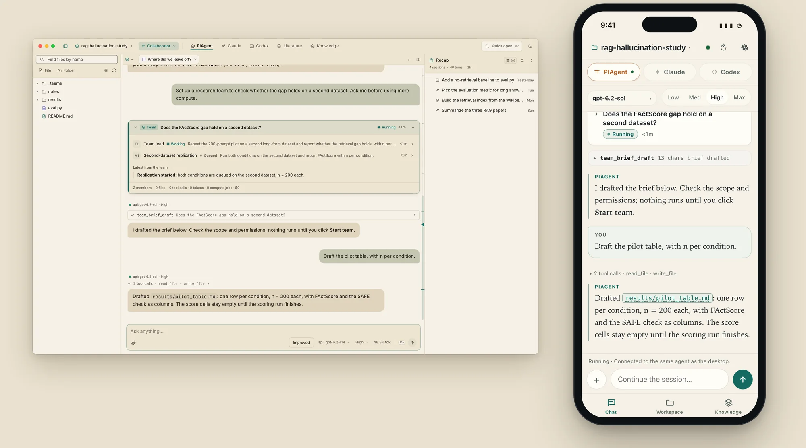
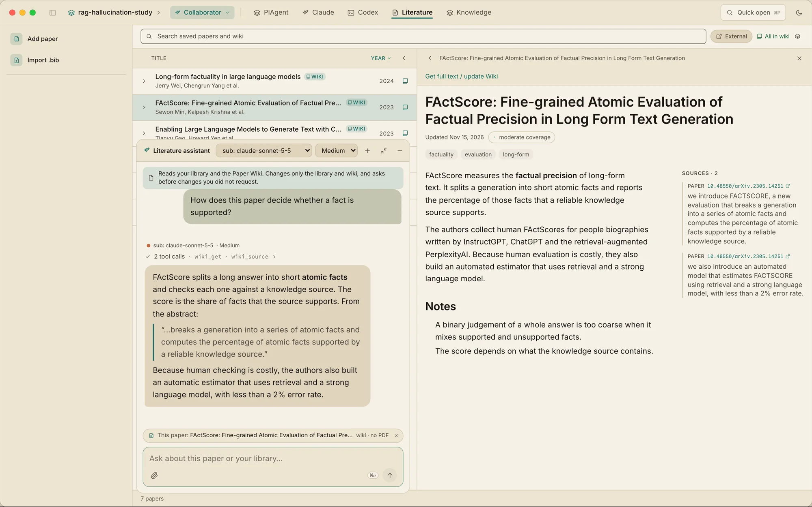
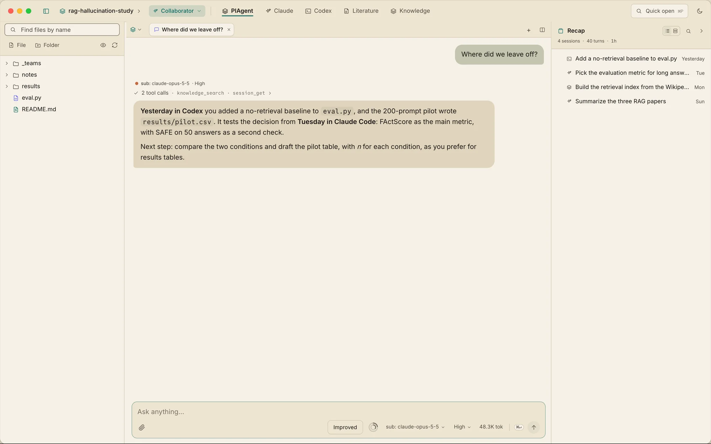
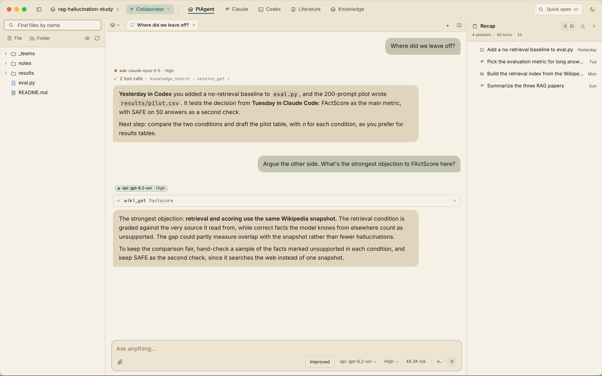
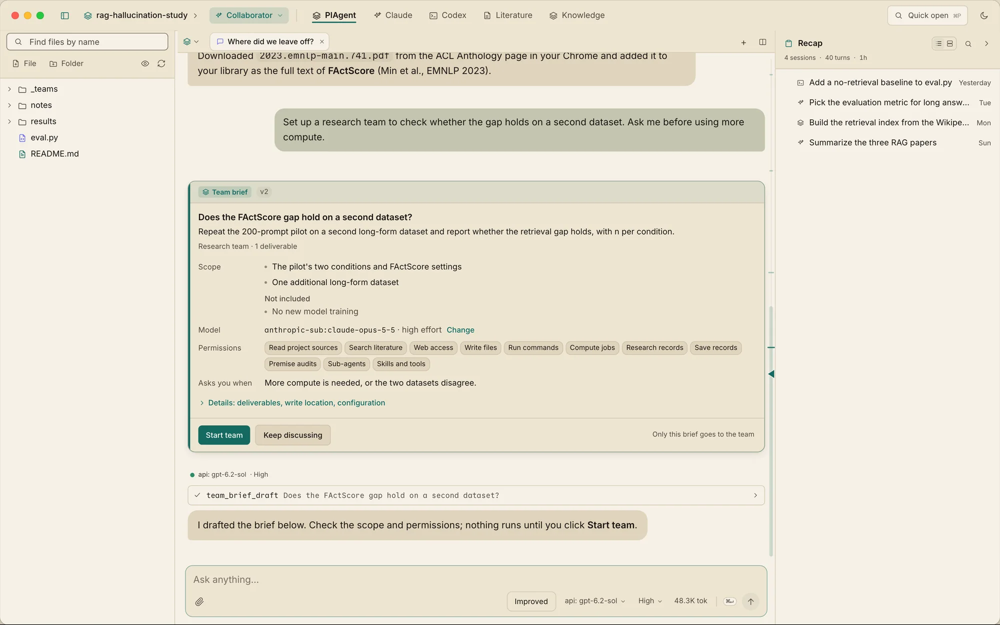
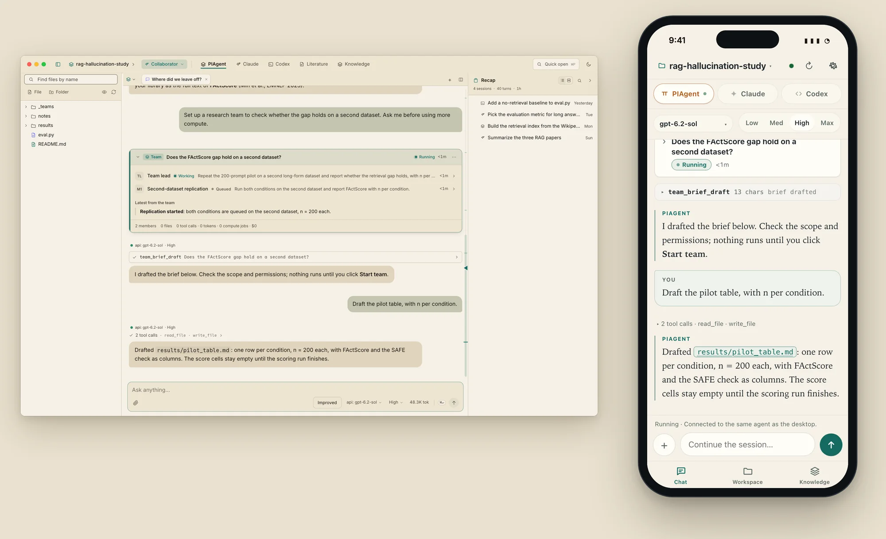

<h1 align="center">Research Pilot</h1>

<strong>One desk for your agents, your papers, and your notes.</strong> 
Run Claude Code, Codex, and the built-in PIAgent side by side. What you read and decide stays attached to the project, with sources you can check long after the chat is closed.

<a href="https://github.com/daidong/DIR-Agent/releases/tag/v0.8.14"><strong>Download 0.8.14</strong></a> ·
<a href="https://daidong.github.io/DIR-Agent/">Website</a> ·
<a href="https://youtu.be/RheGeG1U5no">Watch the demo</a> ·
<a href="https://github.com/daidong/DIR-Agent/releases/tag/v0.8.14">Release notes</a> ·
<a href="https://github.com/daidong/DIR-Agent/issues">Report a problem</a>

macOS (Apple Silicon) · Ubuntu / Debian (x86-64 and ARM64) 
Works with Claude and ChatGPT subscriptions, GitHub Copilot, Anthropic and OpenAI API keys, or Gemini through Google Cloud Vertex AI or a Gemini API key.

## Why we built it

**A new terminal shouldn't mean starting from scratch.** Jump between Claude Code, Codex, and a pile of PDFs, and context scatters fast. Research Pilot connects every agent on a project to the same saved papers, Paper Wiki, and past decisions, with dates and links back to where each note came from.

## New in 0.8.14

- **Starting after an upgrade from an old version.** A package installed by hand over a release older than 0.8.3 could fail to start with "PROTOCOL_UNSUPPORTED: Unsupported daemon protocol undefined", because the old version's data service was still running. Research Pilot now asks before it starts whether to restart the services; choose **Restart Services**.
- **One Settings page per model source.** Subscriptions (Claude, ChatGPT, GitHub Copilot, Google Cloud) and API keys (Anthropic, OpenAI, Gemini) each have their own page with the models they offer. Gemini 4 Neon and Hydrogen offer **Extra high** reasoning. Self-hosted model servers are hidden for now.
- **Documents read better.** Wide images and tables fit the editor, formulas that start with a digit render, a short list of HTML tags renders everywhere, and the file viewer's buttons stay inside a narrow pane.
- **Clearer PIAgent steps.** Tool calls and thoughts form one list in order, and sub-agents show what they are doing while they run.
- **From 0.8.14,** click **Update** at the top right. **From 0.8.12 or earlier,** install 0.8.14 once by hand (see [Upgrade](docs/installation.md#upgrade-an-existing-installation)); later versions arrive through the Update button.

[Full release notes](https://github.com/daidong/DIR-Agent/releases/tag/v0.8.14)

## What it does

### See the exact lines behind each answer.

Open a paper in **Literature** to ask about a method, a baseline, or how papers in your library compare. Answers quote the text directly, and the Paper Wiki keeps verbatim excerpts next to each summary so you can verify claims without hunting through the PDF.

- Search academic indexes and save papers to your library
- One Paper Wiki across your projects, backed by verbatim quotes
- Attach local PDFs as full text for papers in your library

### Keep track of why you made a call.

Agents record project decisions, preferences, and hard-won lessons along with the date, the session they came from, and when they apply. Come back next week and a new chat picks up with that context already in hand.

- Inspect, edit, or delete any memory in the **Knowledge** tab
- Say “don't remember this” when something should stay off the record
- Every entry links back to its source turn rather than standing in as blind fact

### Claude Code, Codex, and PIAgent on the same project.

Keep Claude Code and Codex in their own terminal tabs alongside the built-in PIAgent. All three draw from the same library and project memory, and **Recap** puts every past session on one timeline no matter which agent ran it.

- Runs your installed `claude` and `codex` CLIs with your own login
- PIAgent can read earlier Claude Code and Codex transcripts
- Split panes let you read files or papers right next to the chat

### Switch models mid-conversation.

Swap models inside a PIAgent thread without starting over. Use the Claude, ChatGPT, or GitHub Copilot subscriptions you already pay for, plug in Anthropic or OpenAI API keys, or connect Gemini through Google Cloud Vertex AI or a Gemini API key. Each reply tags which model wrote it.

- Reuses your Claude Code and Codex CLI logins
- Adjust reasoning effort per conversation
- Usage rings show how much subscription quota you have left

### Hand bigger jobs to a team, after you approve the plan.

When a task is too large for a single chat, ask PIAgent to draft a team brief covering the goal, scope, model, permissions, and when to check in with you. Nothing runs until you click **Start team**. Once it starts, every member's messages and outputs stay in the thread.

- Separate team types for open-ended research and draft revision
- Answer a team's questions in the chat card or from your phone
- Keeps a full log of tasks, messages, and outputs

### Let PIAgent use your Mac browser when you allow it.

Once you approve, PIAgent can work in apps on your Mac in the background, such as grabbing a paper PDF from a publisher page in your signed-in Chrome. A live banner stays visible in the chat with a one-click stop button.

- Approve for a single turn or for the whole conversation
- Add downloaded PDFs to your paper library
- macOS only for now

### Check in on a session from your phone.

Pair your phone once to read replies, send a follow-up, switch models, or unblock a waiting team while you're away from your desk. Everything still runs on your computer; the phone connects to it over Tailscale.

- Works with PIAgent, Claude Code, and Codex sessions
- Notifications when a team needs your input
- Private Tailscale connection (your computer needs to stay on)

### See how a project comes together

A 100-second tour recorded in the actual app.

## Download and start

| Computer | Recommended package | Alternative |
| --- | --- | --- |
| macOS · Apple Silicon (M1 or later) | [DMG](https://github.com/daidong/DIR-Agent/releases/download/v0.8.14/Research-Pilot-0.8.14-mac-arm64.dmg) | [ZIP](https://github.com/daidong/DIR-Agent/releases/download/v0.8.14/Research-Pilot-0.8.14-mac-arm64.zip) |
| Ubuntu/Debian · Intel / AMD 64-bit | [deb](https://github.com/daidong/DIR-Agent/releases/download/v0.8.14/Research-Pilot-0.8.14-linux-amd64.deb) | [AppImage](https://github.com/daidong/DIR-Agent/releases/download/v0.8.14/Research-Pilot-0.8.14-linux-x86_64.AppImage) |
| Ubuntu/Debian · ARM 64-bit | [deb](https://github.com/daidong/DIR-Agent/releases/download/v0.8.14/Research-Pilot-0.8.14-linux-arm64.deb) | [AppImage](https://github.com/daidong/DIR-Agent/releases/download/v0.8.14/Research-Pilot-0.8.14-linux-arm64.AppImage) |

On macOS, open the DMG and drag Research Pilot into Applications; the app is signed and notarized by Apple. On Ubuntu/Debian, install the downloaded deb with `sudo apt install ./Research-Pilot-0.8.14-linux-amd64.deb` (use the arm64 filename on ARM). AppImages on Ubuntu 24.04 may need `libfuse2t64`; the arm64 AppImage also needs `zlib1g-dev`.

1. **Install** the package for your OS. The runtime is bundled, so you don't need to install Node.js, Docker, or a separate server.
2. **Connect a model.** Sign in once with the Claude Code or Codex CLI from a terminal (PIAgent shares that login), sign in to GitHub Copilot under **Settings → GitHub Copilot**, add an API key under **Settings → Anthropic API**, **OpenAI API** or **Gemini API**, or connect Vertex AI under **Settings → Google Cloud**. On first launch a built-in setup check points out anything missing; **Settings → Setup** reopens it any time.
3. **Open a project folder.** Pick an existing repository or an empty folder. Your project files stay where they are, and research records live in `~/.pipilot`.
4. **Ask.** Try asking it to summarize a repo you opened, or find and save recent papers on a question you're starting.

Windows and Intel Macs are not supported yet. Choose a named application package; GitHub's automatic “Source code” archives are a snapshot of this documentation repository, not the application.

[Detailed installation and setup](docs/installation.md) covers CLI login, AppImage dependencies, optional tools, API keys, upgrades and troubleshooting.

## Good to know

### Work across computers

Connect another computer through **Settings → Servers** to open its projects from the desktop. Workspaces are grouped by computer, and the interface identifies the machine that owns the active project. Remote sessions, file previews and supported transfers use the connected instance.

### Choose how to work

**The agent is the execution engine.** Claude and Codex run their installed CLIs inside the app. PIAgent runs in a separate bundled process and supports configured model providers and OpenAI-compatible local endpoints. Their available tools and authentication differ; the app does not make them interchangeable.

**The work mode sets the session's defaults.** Use the workspace mode picker for Collaborator and enable the experimental choices to explore Ideator, Builder, Teacher, or Policy & Records. These emphasize general collaboration, exploring ideas, engineering, teaching, or source-based policy and record work. Modes are built in and cannot be edited; each new session uses the mode's current version. A mode is a starting style, not proof of better answers or a security sandbox.

Changing modes can end the workspace's ordinary foreground sessions. The app shows the affected sessions before you confirm and starts fresh sessions with the new mode. Changing PIAgent's model or reasoning effort is a separate choice; its workspace selection is restored after an app restart.

### Papers, knowledge, and memory

| Information | What it is for | Scope |
| --- | --- | --- |
| **Paper Wiki** | Source-backed summaries and connections you can revisit | Shared across projects |
| **Saved papers and notes** | The material a particular project relies on | Associated with the workspace |
| **Project memory** | Reusable preferences, configuration references and observed experience with sources and context | Ordinary sessions pre-load compact summaries; full records are read when needed |
| **Conversation history** | What happened in a session | Available for review and continuation |

The research workflow starts with existing knowledge, searches for gaps, reads original sources for exact claims, and saves useful material. Literature search supports academic indexes; general web search in PIAgent uses a Brave Search key configured under **Settings → Web search**. Full-text access depends on the paper and configured sources.

The **Domain knowledge** panel separately manages reusable rules. Turning a rule's **Use** switch on approves its current content for use. The workspace's **Load rules in conversations** switch controls loading. Opening the panel only marks rules as seen; it does not turn them on.

You can ask an agent not to remember particular information, correct a record, or forget it. Saved summaries still need checking against original evidence when accuracy matters.

### Teams

Use ordinary chat for quick work. For a larger research or writing task, ask PIAgent to prepare a team brief, review it, and click **Start team** yourself to authorize execution. Drafting a brief does not start work. You talk to a team in the PIAgent conversation that owns it, on desktop or phone.

Research and manuscript teams are separate launches: turning a research result into a manuscript requires a new writing brief and another **Start team** confirmation. Permissions and delivery checks apply; a completed task does not establish that a scientific conclusion is correct. Provider quotas and external service charges still apply. On Linux, team shell execution requires working `bubblewrap` isolation; it is refused when isolation is unavailable.

### Longer PIAgent sessions

PIAgent keeps large tool results in local storage and retrieves their original text when needed. Older conversation can be compressed while the complete session history remains available; the interface shows when this is happening. If a provider rejects an oversized request, PIAgent compacts and retries once. Provider limits still apply, and changing providers can require rebuilding the model's working context.

### Phone companion

Install and connect Tailscale on both devices, turn on **Settings → Phone** on the desktop and click **Show pairing code**. Scan the QR code with the phone's camera or type the six-digit code. A code pairs one phone, once, within ten minutes; each paired phone gets its own key and can be removed in Settings without affecting the others. For notifications on iOS, add the page to the Home Screen. HTTPS (Tailscale certificates) is needed for Home Screen install and notifications. [Phone setup and access controls](docs/installation.md#7-optional-follow-and-drive-sessions-from-your-phone).

### Permissions and your data

Desktop and phone sessions launch Claude Code with `--dangerously-skip-permissions` and Codex with `--dangerously-bypass-approvals-and-sandbox`. These agents can run commands, edit or delete files, and use the network with your OS account's permissions without per-action approval. Codex's own sandbox is disabled. This fixed launch behavior does not grant administrator privileges. Use trusted tasks and keep backups. PIAgent asks before risky commands, and desktop control needs your approval.

Research data lives under `~/.pipilot` by default. Your documents and code stay in the project folders you choose. Opening a workspace can synchronize integration files under `.agents`, `.claude` and `.pipilot`; your own `AGENTS.md` and `CLAUDE.md` content is preserved.

Keep in mind that local storage doesn't mean offline execution: prompts and searches still go to whichever model providers, search APIs, and external tools you configure. Credentials, account access and provider charges are configured separately.

From 0.8.13 on, new versions arrive through the **Update** button at the top right; updating closes active conversations and tasks on this computer after you confirm. To upgrade by hand (required once from 0.8.12 or earlier), finish active work, quit the app, replace the application and reopen it; if services of the previous version are still running, the app asks to restart them. Keep a backup of `~/.pipilot` and your project folders; do not delete research data as an upgrade step.

## Help

- [Installation, configuration and troubleshooting](docs/installation.md)
- [What changed in 0.8.14](https://github.com/daidong/DIR-Agent/releases/tag/v0.8.14) · [All releases](https://github.com/daidong/DIR-Agent/releases)
- [Issues](https://github.com/daidong/DIR-Agent/issues) — include app version, OS, CPU, package type and reproduction steps. Remove credentials and private research from diagnostics before sharing.

This public repository hosts application packages, documentation and community issues. The application source is maintained separately. Claude Code, Codex, ChatGPT, GitHub Copilot, Google Cloud and other names belong to their owners; Research Pilot is not affiliated with Anthropic, OpenAI, Google or GitHub.
